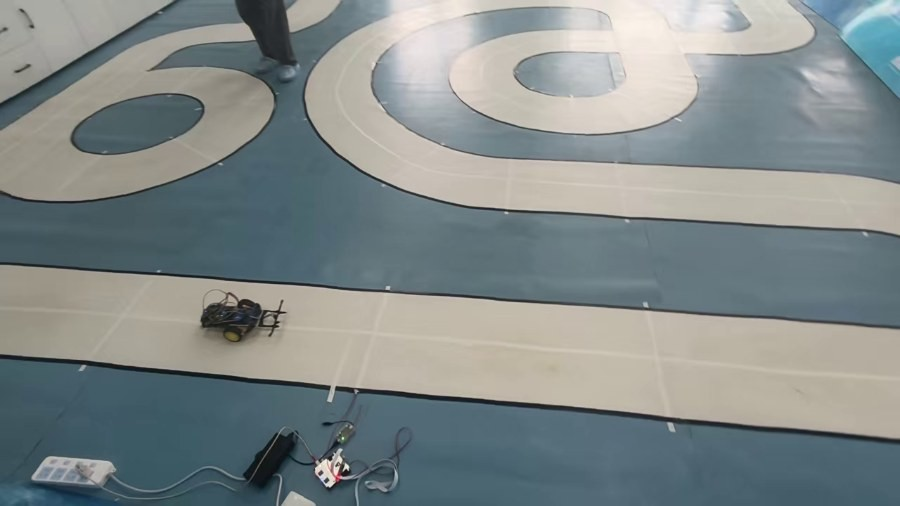

# 电磁循迹小车 · 单圈 42.985 秒

西南民族大学智能汽车大赛（电磁循迹组）参赛车。基于 STM32F103C8T6 + 双水平电感 + L298N，纯 C 手写控制环，无 RTOS。

**比赛成绩：42.985 秒 / 圈**（赛道全长约 34 m，平均速度 0.79 m/s，含自动停车）。



> 画面下方带绿灯的黑盒是计时探头，车上磁体两次经过它即完成一圈。

---

## 1. 这套代码解决了什么

| 问题 | 做法 | 效果 |
| --- | --- | --- |
| 电感读数受电压/距离影响，绝对差值不可用 | 归一化成**差比和** `(R−L)/(R+L)` | 两侧同时变化时比值不变，抗电源波动 |
| 每次上电零点都不一样 | 开机静止采零点，且**等车放稳**（300 ms 内波动 <2%）才采 | 三次上电零点是同一个值（此前是 +38/+700/+534） |
| 纯 P 必然左右摆 | 位置式 PD，微分**按时间求导** + 一阶低通（τ≈5.5 ms） | 直道摆幅 52 mm → 19 mm |
| 提速后转弯能力骤降 | **转弯自动降速**：差速越大基础速度越低 | 满舵曲率 1.61/b → 2.00/b（+24%） |
| 一直走弯道最外圈，白跑路 | **弯道切内** `CUT_IN`：把转向量减掉一份，车稳定吃在内侧 | 训练场单圈 17.2 s → 16.4 s |
| 丢线后正反馈失效，直冲出赛道 | 丢线时保持方向并抬到 `LOST_ERR`，同时冻结微分 | 不再"直行冲出去" |
| 跑完不停车，被罚 10 秒 | `STOP_MS` 时间到断电并在屏上显示用时 | 停在线后约 0.3 m，符合规则 |

---

## 2. 硬件

| 项目 | 型号 / 引脚 |
| --- | --- |
| 主控 | STM32F103C8T6（64 KB Flash / 20 KB RAM） |
| 电机驱动 | L298N，TIM4 四通道，2 kHz，PWM 0~999 |
| 电机 | PB6/PB7 = 左（CH1/CH2），PB8/PB9 = 右（CH3/CH4） |
| 电感 | PA0 = 左水平，PA3 = 右水平（PA1/PA2 为竖直通道，本版未用） |
| 采样 | ADC1 + DMA 循环搬运 4 通道，采样时间 239.5 周期 |
| 显示 | 0.96" 7 针 SPI OLED（SSD1306）：PA5=SCLK / PA7=MOSI / PA4=RES / PA6=DC / CS→GND |

> 注意：`motor.h` 里 `Speed_Max` 必须与 `ARR` 一致（999）。若写成 10000，speed 一旦超过 999 两轮直接恒 100% 占空比、**完全没有差速**，看起来像"算法不转弯"。

---

## 3. 参数（比赛用）

```c
int   speed     = 950;     // 直道基础速度
int   Steer_Max = 638;     // 最大差速
float p         = 1.02f;   // 比例
float d         = 0.075f;  // 微分
int   speed_min = 450;     // 弯道最低基础速度
int   Dead_Zone = 25;      // 死区

#define CUT_IN        260   // 弯道切内量（约偏内 5.2 cm）
#define STOP_MS       43700 // 自动停车时刻（ms，从发车算起）
#define USE_AUTO_STOP 1     // 1=开 0=关（代码保留原位）
```

约束：外轮 = `spd + |steer| ≤ 999`，由 `if(spd > 999 - asteer) spd = 999 - asteer;` 保证；内轮由 `|steer| ≤ spd` 保证不倒转。

---

## 4. 编译与烧录

Keil MDK（armclang）打开 `src/USER/xxx.uvprojx` 直接编译，或用脚本：

```bash
# 改参数（顺序：speed Steer_Max p d speed_min Dead_Zone）
python tools/set_params.py 950 638 1.02 0.075 450 25

# 编译（宏：SHOW_ON_OLED / STOP_MS / CUT_IN / USE_AUTO_STOP）
python tools/build_fw.py "src" "build" "SHOW_ON_OLED=0,STOP_MS=43700,CUT_IN=260,USE_AUTO_STOP=1" car_run
```

`hex/` 里是已经编好的成品，可直接烧录：

| 文件 | speed | 切内 | 停车 | 说明 |
| --- | --- | --- | --- | --- |
| `1_主力_950切260_停43.7.hex` | 950 | 260 | 43.7 s | **比赛用，42.985 秒** |
| `1_主力_950切260_停44.2.hex` | 950 | 260 | 44.2 s | 停车更保险（赛道略长时用） |
| `2_极限A_950切450.hex` | 950 | 450 | 无 | 更贴内，未验证 |

烧录：ST-Link / DAP-Link，SWD（PA13/PA14）。

### 显示页面

| 宏 | 页面 |
| --- | --- |
| `SHOW_ON_OLED=0` | 不刷屏（最快） |
| `SHOW_ON_OLED=1` | 调参页：L / R / A1 / A2 / S / B / Z + SAT / LOW / ADJ / OK |
| `SHOW_ON_OLED=2` | 状态页：E / T / L / R / S / Z + RUN / FULL / SAT / LOST |
| `SHOW_ON_OLED=3` | 记录页：EMAX / LOST / FULL / N / S |

---

## 5. 上电流程

```
上电 → 实时状态页（L/R/S/E）→ 车放稳（波动 <2%）
     → 采零点 200 ms → READY → OK 2 → OK 1 → OK 0 → 自动发车
```

车必须放在**导线正中**：零点就是拿这一刻当"正中"，放偏了整趟都会往一边拽。

---

## 6. 速度与圈时

训练场（12.6 m）：

| speed | 单圈 | 备注 |
| --- | --- | --- |
| 555 | 23.0 s | |
| 605 | 21.0 s | 效率 97% |
| 665 | 19.78 s | 开始掉效率 |
| 720 | 19.2 s | 同一弯稳定打滑 |
| 800 | 17.5 s | |
| 850 | 17.6 s | **倒退**，进入"锯齿区" |
| 900 + 切内 260 | 16.4 s | 走线省下的 |
| 950 + 切内 260 | **16.0 s** | 训练场最快 |

比赛场 34 m：**42.985 s**（同一套 950 + 切内 260）。

---

## 7. 已知问题

1. **`CUT_IN` 在降速公式之前生效**，所以切内不只挪位置，还顺手减少了弯道降速。切 260 时弯道基速 621，切 400 时 761（+23%），同时差速从 378 掉到 238（−37%），结果 `999 + 切内 400` 第一个弯就打滑。
   修法（**未验证**）：降速用切内前的指令幅值，把走线与弯速解耦。
2. L298N 压降约 2 V 且随电流增大，900 以上再给占空比基本换不到速度。
3. PWM 频率不能提高：L298N 电枢电感限制，20 kHz 以上扭矩明显下降，2~8 kHz 是甜点区。

---

## 8. 目录

```
src/                固件源码（CORE / USER / SYSTEM / STM32F10x_FWLib）
  USER/main.c       控制环、参数、起跑与停车流程
  CORE/OTHER/adc.c  采样、差比和、零点、丢线判定
  CORE/OTHER/display.c  OLED 各页面
  CORE/OTHER/oled.c 软件 SPI 驱动
tools/              改参与编译脚本
hex/                成品固件
docs/技术记录.md     完整技术记录（硬件/算法/参数演进/比赛复盘/失败清单）
docs/images/        现场照片与录像关键帧
```

完整过程（含 16 个失败尝试、比赛日复盘、999 打滑的定量分析）见 **[docs/技术记录.md](docs/技术记录.md)**。

---

## 9. License

MIT
