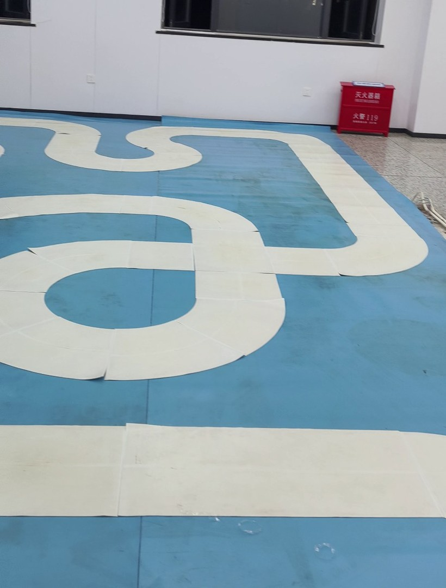
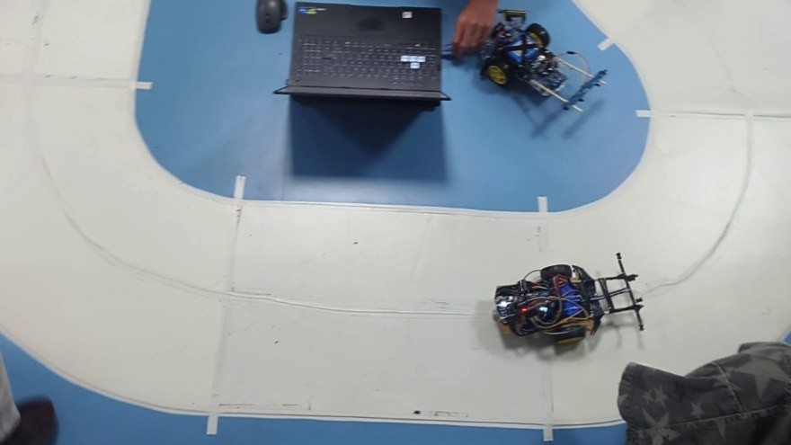
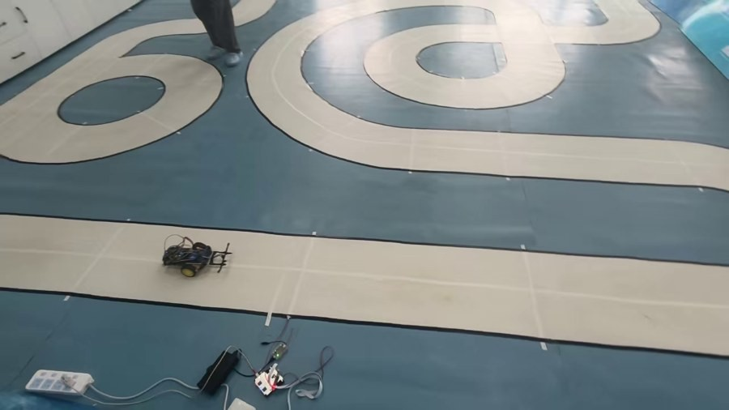
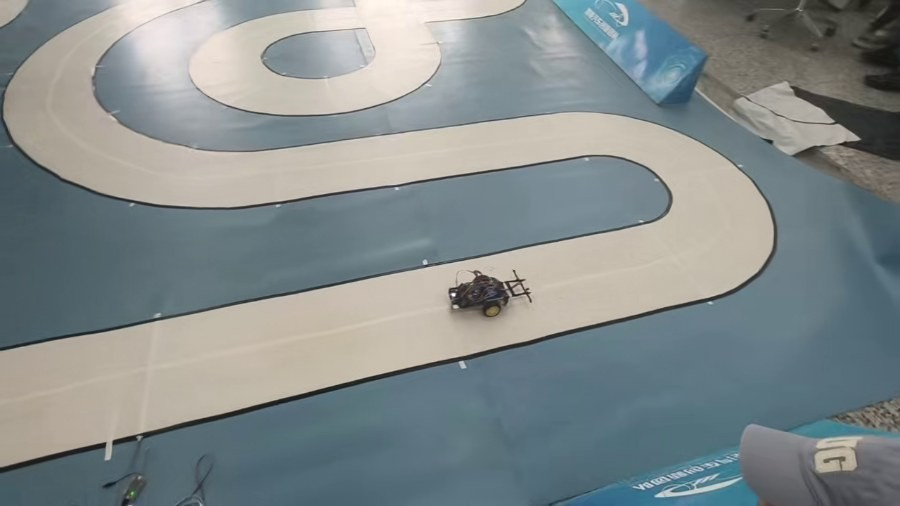
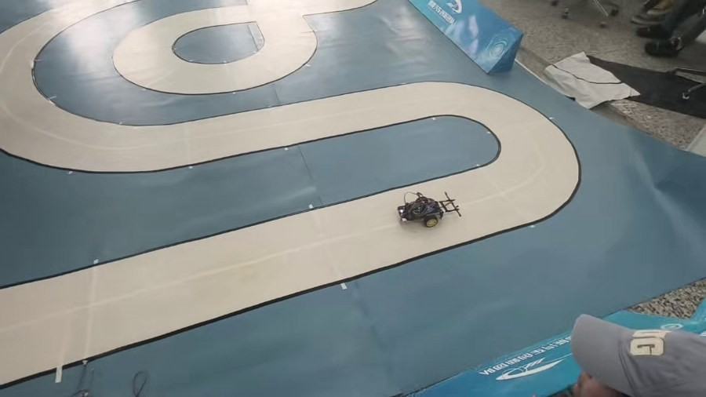
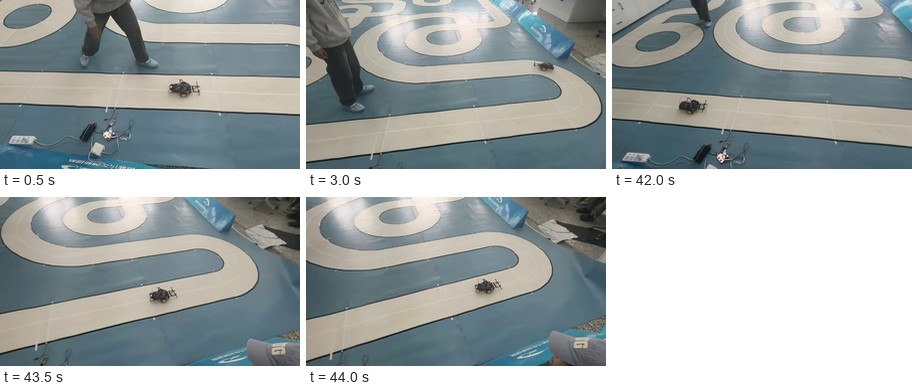

# 电磁循迹小车 · 完整技术记录

**项目**：西南民族大学智能汽车大赛 · 电磁循迹组

**周期**：2026-11-01 ~ 2026-11-08

**最终成绩**：**42.985 秒**（比赛场一圈，赛道全长约 34 米）

**最终固件**：`1_主力_950切260_停43.7.hex`

---

## 0. 一页速览

| 项 | 内容 |
| --- | --- |
| 主控 | STM32F103C8T6（64KB Flash / 20KB RAM） |
| 驱动 | L298N，TIM4 四通道，2kHz，占空比 0~999 |
| 循迹 | 双水平电感差比和 + 开机自动零点 |
| 控制 | 位置式 PD（按时间求导 + 低通）+ 转弯自动降速 + 弯道切内 |
| 显示 | 0.96" 7 针 SPI OLED（SSD1306），软件 SPI |
| 训练场最快 | 16.0 秒（约 12.6m，950 + 切内 260） |
| 比赛场成绩 | **42.985 秒**（约 34m，950 + 切内 260，自动停车 43.7s） |
| 最大教训 | ①停车时刻宁大不小 ②切内会顺手放开弯道限速 |

**一句话结论**：这台车能**稳定复现**的速度上限是 `speed 950 + 切内 260`；`999` 能跑但第一个弯就打滑，属于"不可靠"。

---

## 1. 任务与规则

### 1.1 赛道

| 项 | 训练场 | 比赛场 |
| --- | --- | --- |
| 面材 | 白色胶带贴地 | 白色胶带贴在蓝色 PVC 地胶上 |
| 宽度 | 约 40cm | 约 40cm（两处一致） |
| 电磁线 | 白带正中间 | 白带正中间 |
| 长度 | 约 12.6m | **约 34m** |
| 形态 | 大回环 + 短直道 | 一整间房：2~3 组 S 形蛇行 + 多段长直道 + 多个回头弯 |



### 1.2 规则要点（直接决定固件设计）

1. **每队 3 人进场，总共 8 分钟**，期间可申请**无限次正式运行，取最好一次**。软硬件调整都算在 8 分钟内。
2. **跑完一圈必须自动停在起始线之后 2 米内的赛道内**；没停进规定区域，**计时 +10 秒**（不是取消成绩）。
3. 有一个轮子超出赛道边沿即判未完成；单圈 300 秒上限。
4. 计时方式：**磁体吸在车上**，两次经过同一个探头，取两次之间。
5. 日程：09:00~09:15 收车模抽签（过时视为放弃）；09:20 起按抽签顺序，叫三次未到视为放弃。

> 规则第 2 条是全项目最容易被忽略、代价最大的一条：原固件没有停车逻辑，跑完会继续跑第二圈，等于 19.78 秒直接变成 29.78 秒。后期所有固件都带自动停车。

---

## 2. 硬件

### 2.1 引脚分配

| 功能 | 引脚 | 说明 |
| --- | --- | --- |
| 电机 PWM | PB6 / PB7（左，CH1/CH2）<br>PB8 / PB9（右，CH3/CH4） | TIM4 四通道，ARR=999，2kHz |
| 电感 | PA0 = 左水平<br>PA3 = 右水平 | PA1 / PA2 是竖直通道，未启用 |
| 采样 | ADC1 + DMA 循环搬运 4 通道 | 采样时间 239.5 周期 |
| OLED | PA5=SCLK / PA7=MOSI / PA4=RES / PA6=DC / CS→GND | 软件 SPI，7 针屏 |

> **一个致命的历史坑**：`Speed_Max` 在 `motor.h` 里原本是 10000，而 ARR 是 999。一旦 speed 写成 5000，两轮直接恒 100% 占空比、**完全没有差速**，看起来像"算法不转弯"。现已改为 999。

### 2.2 电位器标定（信号链增益）

板上运放有多个可调电阻，其中**最右侧那颗是公共增益**。拧错通道会导致读数整体偏低或饱和。

最终工作点：

| 指标 | 数值 |
| --- | --- |
| 左电感 L | 753 |
| 右电感 R | 764 |
| 不平衡度 B | +2% |
| 零点 Z | 24 |

屏幕上的 `B=(R−L)×200/(L+R)`，与程序内部 `err=(R−L)×1000/(R+L)` 的换算是 **`err = 5B − Z`**，这个关系排障时非常有用。

---

## 3. 算法（核心）

### 3.1 归一化改差比和

```c
err = (R - L) * 1000 / (R + L);
```

不用绝对差值，是因为**差比和对"两侧同时变化"不敏感**：电池电压下降、整体抬高、地面材质变化，都会同时影响两路，比值不变。这是本车能稳定跑完 34 米的前提。

### 3.2 开机自动零点

上电时车静止，采集左右电感读数取平均作为"正中"基准 `Z`，之后 `err` 减去 `Z`。

**这里踩过一个很深的坑**：早期是"上电即采"，200ms 内采满样本。如果那时车还在手里、或刚放下还没稳，零点就采歪了。同一台车连开三次，`Z` 分别是 **+38 / +700 / +534**——三个数说明采的根本不是同一状态。

**修正（v14 起）**：先停电机，静止采零点。**再修正（11-07）**：先显示实时状态页，等左右之和连续 300ms 波动小于 2% 才认为"车放稳了"，此时才开始采零点。

### 3.3 PD 控制

```c
der    = (pwm_error - last_e) * 1000;      // 1kHz → 每秒变化率
d_filt += 0.18f * ((float)der - d_filt);   // 低通，τ≈5.5ms
pid_Output = (int)(pwm_error * p) + (int)(d_filt * d);
```

- 用**按时间求导**而不是按周期差分，这样改控制周期不会改阻尼。
- 微分必须低通，否则电感噪声会被放大成满舵。
- **死区 25**：`|err|<25` 当作 0，抑制中心附近的来回修正。死区是"静默区"，不是可有可无的装饰。

> **试过但失败的做法**：把微分改成用"过死区之前"的原始误差。本意是消除死区穿越造成的假跳变，实际结果**更抖**——死区原本在当噪声隔离带用，拆掉等于把电感噪声全灌进微分，形成正反馈。已回滚。

### 3.4 转弯自动降速（结构性修正，+24% 转向能力）

PWM 预算 0~999 是**左右两轮共用**的，外轮 = `spd + steer`。速度越高，留给差速的空间越小：

```
速度 605、差速 580 → 外轮需要 1185，实际被削到 999
→ 真实差速只有 974，最大曲率 974/605 = 1.61/b
```

而 400 版是 800/400 = **2.00/b**。也就是说提速把转弯能力砍掉了 20%，表现为"最需要转向的一刻增益突然减半"→ 打滑、甩出去。

**做法**：差速越大，基础速度自动降得越多。

```c
asteer = |steer|;
spd = speed - asteer*(speed - speed_min)/Steer_Max;
if(spd < speed_min) spd = speed_min;
if(spd > speed)     spd = speed;
if(spd > 999 - asteer) spd = 999 - asteer;   // 外轮永不削顶
if(|steer| > spd) steer = ±spd;              // 内侧轮不倒转
```

效果：满舵曲率从 **1.61/b 回到 2.00/b**（+24%），外轮最高 968 不再削顶，内轮不反转。

`speed_min` 不是随便填的：665 版若填 460，err≈500 处外轮会到 **1004** 削顶，曲率曲线出现折点；必须 ≤453。

### 3.5 弯道切内 `CUT_IN`（最有效的提速手段）

**动机**：控制器一直让 `err→0`，等于永远走弯道**最外圈**那条弧。弧长正比于半径——半径 30cm 的弯往里挪 4cm，弧长少 13%。这是"不提高速度也能省时间"的唯一办法。

```c
if(pid_Output >  100) { pid_Output -= CUT_IN; if(pid_Output < 0) pid_Output = 0; }
if(pid_Output < -100) { pid_Output += CUT_IN; if(pid_Output > 0) pid_Output = 0; }
```

下限保护是必须的：`CUT_IN` 大于当前指令时会**反打成反向**，直接把车甩出赛道。

实测收益（训练场 900 版）：切内 200→260，单圈 **17.2 → 16.4 秒**，省 0.8 秒。

> **但这个改动有副作用，是比赛失利的直接原因**：`CUT_IN` 是在降速公式**之前**减掉的，所以切内不仅挪位置，还**顺手减少了弯道降速**。切得越狠，弯道跑得越快。详见第 7 节。

### 3.6 丢线处理

早期丢线时把 `track_err` 清零，导致**正反馈失效、车直行冲出赛道**（视频逐帧确认车身角度在 1.96~2.32s 完全冻结）。

修正：

```c
if(zero_done && sum_ref>0 && s < sum_ref/6){
    if(lost_cnt<250) lost_cnt++;
    adc_lost = 1;
    if(lost_cnt>=5){                       // 连续 5ms 才认定
        int d = (track_err>0)?1:((track_err<0)?-1:lost_dir);
        if(d) { lost_dir = d; track_err = d*LOST_ERR; }   // LOST_ERR=400
    }
}
```

同时**微分整体冻结**（`der=0, d_filt=0, last_e=pwm_error`），否则偏差被强制拉到 400 那一下会产生天文数字的变化率，再给一脚反舵。

### 3.7 起跑流程

比赛是"车头过起跑线才开始计时"，所以车要先放在线前，且必须压在导线正中（零点就是拿这一刻当"正中"）。

```
上电
 → 实时状态页（L / R / S / E + PUT ON LINE）
 → 左右之和连续 300ms 波动 <2%（10 秒兜底）
 → 采零点 200ms
 → READY → OK 2 → OK 1 → OK 0
 → 自动发车
```

数字从 2 数到 0 共 2 秒，够松手和裁判准备。

### 3.8 自动停车

```c
run_ms++;
#if USE_AUTO_STOP
if(run_ms >= STOP_MS){
    motor_control(0,0);
    page_stop(run_ms);          // 屏上显示本次用时
    for(;;) motor_control(0,0); // 死循环，必须重新上电
}
#endif
```

- `STOP_MS` 从 `control()` 第一次执行开始算。
- 停车是**断电滑行**，不是刹车；0.7 m/s 时断电后还会滑 0.3~0.5 米。
- 停车页会把本次用时打在屏上，不用另外掐表。

---

## 4. 参数演进

### 4.1 早期（v1~v25，11-01 ~ 11-06）

| 版本 | 主要改动 | 结果 |
| --- | --- | --- |
| v1 | `speed 5000→400`、`Speed_Max 10000→999` | 两轮终于有差速 |
| v2 | 归一化 → **差比和**；加**开机自动零点** | 能跑 |
| v4/v5 | 提速到 550 | U 形直角弯**滑出赛道** |
| v7 | 修零点"放弃"bug | 22:49 赛道 11.4s 全程未出界 |
| v8 | **1kHz 定周期 + 真微分**（低通/限幅/首周期跳过） | 仿真大幅改善 |
| v13 | 显示驱动 I2C → **4 线 SPI** | 控制参数一行未动 |
| v14 | **修零点采集时机**（先停电机再采） | 三次上电 Z=38/700/534，证明旧逻辑采的是跑动样本 |
| v20 | ①丢线保持方向抬到 400 ②**转弯自动降速** | 满舵曲率 1.61 → **2.00/b** |
| v21 | speed 665 / speed_min 450（硬约束） | 外轮峰值 988，不削顶 |
| v22 | speed 720 / Steer_Max 700 / p 1.12 | 实测 19.2s，但同一弯稳定出界 |
| v25 | **退回 665 并固化**（d 0.075，死区 25） | 720 三次 `LOST` 都在 2.2~3.5s，判定超出整车能力 |

### 4.2 提速实测（训练场，11-06 ~ 11-07）

| speed | 单圈 | 相对上一档 | 备注 |
| --- | --- | --- | --- |
| 555 | 23.0 s | — | |
| 605 | 21.0 s | −8.7%（PWM +9.0%） | 效率 97%，动力链未饱和 |
| 665 | **19.78 s** | −5.8%（PWM +9.9%） | 开始掉效率 |
| 720 | 19.2 s | −2.9%（PWM +8.3%） | 同一弯稳定打滑出界 |
| 750 | 18.6 s | −3.1% | 加了切内 200 的功劳 |
| 800 | **17.5 s** | −5.9% | |
| 850 | 17.6 s | **+0.6%（倒退）** | 进入"锯齿区" |
| 900 | 17.2 s | −2.3% | |
| 900 + 切内260 | **16.4 s** | −4.7% | 走线省下的，不靠电机 |
| 950 | 16.2 s | −1.2% | |
| 950 + 切内260 | **16.0 s** | −1.2% | 训练场最终配置 |

**读这条曲线要注意**：850 比 800 慢是真实的信号——某些弯开始丢时间，直道多跑的正好被弯道吃掉。这时候再加占空比是无效的，**只能改走线**。



### 4.3 最终配置（比赛用）

```c
int   speed     = 950;     // 直道基础速度
int   Steer_Max = 638;     // 最大差速
float p         = 1.02f;   // 比例
float d         = 0.075f;  // 微分
int   speed_min = 450;     // 弯道最低基础速度
int   Dead_Zone = 25;      // 死区
#define CUT_IN   260       // 弯道切内，约偏内 5.2cm
#define STOP_MS  43700     // 自动停车（ms）
#define USE_AUTO_STOP 1    // 1=开 0=关
```

核对：满差速时 `spd = 950 − 378×(950−450)/638 ≈ 654`，外轮 999（限幅生效），不削顶、内轮不倒转。

---

## 5. 屏幕与工具

### 5.1 OLED 接线（0.96" 7 针 SPI）

| 屏上针 | 接到 | 说明 |
| --- | --- | --- |
| GND | GND | 必须共地 |
| VCC | 3.3V（5V 亦可） | 模块带稳压 |
| D0 / SCLK | PA5 | 时钟，上升沿采样 |
| D1 / MOSI | PA7 | 数据，高位先出 |
| RES | PA4 | 复位，低有效 |
| DC | PA6 | 0=命令 1=数据 |
| CS | **GND** | 常选通 |

> 最易错的一步：从 4 针 I2C 屏换过来时，`PA5/PA7` 可以不动，但 `RES/DC` 必须从 `PB0/PB1` 改到 `PA4/PA6`。

### 5.2 页面宏

| 宏 | 页面 |
| --- | --- |
| `SHOW_ON_OLED=0` | 不刷屏，最快 |
| `SHOW_ON_OLED=1` | 调参页（L/R/A1/A2/S/B/Z + SAT/LOW/ADJ/OK） |
| `SHOW_ON_OLED=2` | 状态页（E/T/L/R/S/Z + RUN/FULL/SAT/LOST） |
| `SHOW_ON_OLED=3` | 故障记录页（EMAX/LOST/FULL/N/S） |

### 5.3 编译与改参

```
python tools\set_params.py 950 638 1.02 0.075 450 25
    （顺序：speed Steer_Max p d speed_min Dead_Zone）

python tools\build_fw.py "E:\workbully\car\_build_run\src" ^
       "E:\workbully\car\_build_out" ^
       "SHOW_ON_OLED=3,STOP_MS=43700,CUT_IN=260,USE_AUTO_STOP=1" ^
       out_name
```

**源码目录是 `_build_run\src`**，不是 `参考代码\`（那里是原始 450 版），不要改错。

**校验固件的方法**：
- 全局变量初值 → 直接从 hex 反解二进制，用 `struct.pack` 搜
- 函数内的整型常量（如 `STOP_MS`）→ 会用 `MOVW/MOVT` 立即数，必须 `fromelf --text -c` 反汇编后 grep 立即数
- 是否编进了某段代码 → 数目标函数在反汇编里出现几次（如 `page_stop` 出现 0 次 = 已排除）

---

## 6. 比赛日全程

### 6.1 时间线

| 时刻 | 动作 | 结果 |
| --- | --- | --- |
| 赛前 | 编好 6 档固件（不同速度 / 切内 / 停车），全部带自动停车 | 现场不用改代码 |
| 09:00 | 交车、抽签 | — |
| 进场 | 用不停车版测一圈长度 | **42.5 秒**（当时判断失误，以为是两圈） |
| 确认后 | 按 `42.5 + 1.2 = 43.7` 编停车版 | 就位 |
| 比赛中 | 试 `999 + 切内400 + 停42.0` | ❌ **第一个弯打滑** |
| 比赛中 | 试 `999 + 切内400 + 死区12` | ❌ 同样打滑（排除"抖"这个原因） |
| 最终 | 换回 `950 + 切内260 + 停43.7` | ✅ **42.985 秒** |







### 6.2 比赛录像关键帧

原始视频 `mmexport1794111005180.mp4`（1280×720，44.3 s）。按时间抽帧后的序列：



> **关于视频**：Word 文档无法内嵌可播放的视频，这里用关键帧序列代替。
> 原片请从手机相册导出（文件名 `mmexport1794111005180.mp4`，约 2.3 MB）。
> 需要看完整过程时，直接播放原片，对照上面的时间码定位。

### 6.3 一个被推翻的判断

看到 42.5 秒时，按 0.8 m/s 反算出一圈 34 米，判断"教室放不下 34 米，多半计了两圈"，专门让队员去确认。

**视频证明这个判断是错的**：赛道确实占满一整间房，两组以上 S 弯加多段长直道，34 米成立。

但**方法本身是对的**，交叉校验保留下来，而且它恰好证明数据没错：

```
训练场：12.6 m / 16.0 s  = 0.79 m/s
比赛场：34   m / 42.985s = 0.79 m/s
```

两边平均速度一致 → 车的能力没变，**只是赛道长了 2.7 倍**。这也解释了为什么 16 秒那套停车参数全部作废。

### 6.4 停车余量：只有 0.36 秒

```
发车 t=0
车头过线                ≈ 0.15 s
车尾磁体第一次过探头     ≈ 0.35 s   ← 裁判开始计时
42.985 秒后磁体再过探头  ≈ 43.34 s  ← 停表
程序断电                = 43.70 s
------------------------------------------
过线后多跑 0.36 s ≈ 0.29 米        合格（窗口 2 米）
```

**只要那一趟因为电池掉电慢 0.4 秒，车就会在过线前 5 厘米断电——直接判未完成、0 分，而不是罚 10 秒。**

而且这个风险是隐性的：屏幕上看不出异常，只是少跑了一点点。

---

## 7. 为什么 999 第一个弯就打滑（定量分析）

代码里的顺序是：**先切内，再算降速**。

```c
if(pid_Output > 100) pid_Output -= CUT_IN;   // ① 切内
...
asteer = |steer|;                             // ② 拿切完的值算降速
spd = speed - asteer*(speed-speed_min)/Steer_Max;
```

于是 `CUT_IN` 不只挪位置，还**减少了弯道降速**。代入两版参数（同一个弯，原始指令相同）：

| 弯道原始指令 | 950/切260：差速 · 基速 | 999/切400：差速 · 基速 | 弯速比 | 侧向需求比 |
| --- | --- | --- | --- | --- |
| 300 | 40 · 919 | 0 · 999 | 1.09× | 1.18× |
| 450 | 190 · 802 | 50 · 949 | 1.18× | 1.40× |
| 550 | 290 · 709 | 150 · 849 | 1.20× | 1.43× |
| 638（满指令） | **378** · 621 | **238** · 761 | **1.23×** | **1.50×** |

```
需要的侧向力（∝ v²）  ↑ 50%
能提供的转向（差速）   ↓ 37%
```

两条同时朝坏方向走，**第一个弯必滑**。不是底盘余量不够，也不是抓地力不行，是控制律自己把两件事往相反方向推。

**这也是"950 能跑"的真正原因**：它的「转向能力 / 弯道速度」比值刚好卡在抓地极限之内，而不是因为它慢。

### 正确的改法（未验证）

让降速用「切内之前」的指令幅值，把走线和弯速解耦：

```c
int a_speed = |pid_Output 原始|;      // 切内前
spd = speed - a_speed*(speed-speed_min)/Steer_Max;
```

这样切内只挪位置、不改速度。按这个改法，999 版在同一弯的基速会回落到 621 附近，打滑的风险就消失了。

---

## 8. 失败清单（不要重复）

| 尝试 | 现象 | 结论 |
| --- | --- | --- |
| 单纯加 `speed` 到 720 | 同一弯稳定出界，`LOST` 2.2~3.5s | 打滑，机械问题，参数救不了 |
| 满占空比 900（直道满压） | 直道**速度没变** | L298N 压降随电流增大，多给的电压被吃掉 |
| 999 + 切内400 | **第一个弯打滑** | 切内放开了弯道限速（见第 7 节） |
| 死区收到 12 | 没换来时间，只增加抖的风险 | 抖动与走线无关，别混一起改 |
| 改微分绕开死区 | **更抖** | 死区在当噪声隔离带，拆掉形成正反馈 |
| PWM 频率提到 20kHz+ | 扭矩反而下降 | L298N 电枢电感限制，2~8kHz 是甜点区 |
| `VREFINT` 读电池电压 | 永远读到 3.28V | MCU 是 3.3V 稳压，测不到电池 |
| 起步后退一个车身"偷速度" | 圈时不变，多 0.3 秒 | 加速只需 5cm，退多远都不提高过线速度 |

---

## 9. 经验总结

1. **停车时刻宁大不小。** 偏大 = 罚 10 秒，偏小 = 0 分。两个代价差一个数量级。长赛道用 `T+1.5`，短赛道用 `T+1.2`。
2. **切内是省路径的，但它偷偷放开了弯道限速。** 速度越高，越不能同时把切内和速度推到极限。
3. **提速的瓶颈会从动力转到走线。** 850 比 800 慢是明确信号：这时再加占空比无效，只能改路径。
4. **零点必须在车放稳后采。** 三次上电三个零点（38/700/534）就是最直接的证据。
5. **死区是噪声隔离带，不是可有可无的装饰。** 为了"更跟线"去拆它，代价通常是抖。
6. **视频逐帧是有效的诊断手段。** "丢线后直行"就是靠车身角度在 1.96~2.32s 冻结才定位到的。
7. **一次只改一个变量。** 比赛时改三个（速度 + 切内 + 停车）一起失败，事后要多花一轮才能定位。
8. **固件要提前编好、按用途命名。** 8 分钟里没时间找文件，更没时间现改代码。
9. **交叉校验永远值得做。** 用平均速度反算赛道长度这次误判了，但同一条校验也证明了 42.5 秒是真的。
10. **能稳定复现的 17 秒，胜过不稳定的 16 秒。** 单次比赛只跑几趟，可靠性 > 极限值。

---

## 10. 附录

### 10.1 固件清单（桌面）

| 文件 | speed | 切内 | 停车 | 用途 |
| --- | --- | --- | --- | --- |
| `1_主力_950切260_停43.7.hex` | 950 | 260 | 43.7s | **比赛用，42.985 秒** |
| `1B_电池弱时用_停45.5.hex` | 950 | 260 | 45.5s | 电池掉电时的保险档 |
| `极速_999切400_停42.0.hex` | 999 | 400 | 42.0s | ❌ 打滑，勿用 |
| `2_极限A_950切450.hex` | 950 | 450 | 无 | 未上场 |
| `3_极限B_999切600.hex` | 999 | 600 | 无 | 未上场 |
| `4_退路_800切200.hex` | 800 | 200 | 无 | 保底速度 |

### 10.2 代码开关一览

| 宏 | 位置 | 作用 |
| --- | --- | --- |
| `SHOW_ON_OLED` | `main.c` 头部 | 0/1/2/3 选择显示页面 |
| `STOP_MS` | `main.c` 头部 | 自动停车时刻（ms） |
| `USE_AUTO_STOP` | `main.c` 头部 | 0 关闭 1 开启（代码保留原位） |
| `CUT_IN` | `main.c` 头部 | 弯道切内量 |
| `LOST_ERR` | `adc.c` | 丢线时保持的偏差（400） |

### 10.3 关键文件

| 内容 | 路径 |
| --- | --- |
| 源码 | `E:\workbully\car\_build_run\src` |
| 改参工具 | `E:\workbully\car\tools\set_params.py` |
| 编译工具 | `E:\workbully\car\tools\build_fw.py` |
| 笔记（16 篇） | `E:\obsidian\long\电磁循迹小车\` |
| 接线说明 | `E:\workbully\car\参考代码\接线-SPI屏幕.txt` |

### 10.4 若再战一次

1. 先在训练场定死「切内 + 速度」的安全组合，比赛现场**只调停车参数**。
2. 改降速公式（用切内前的指令），解耦走线与弯速，再试 999。
3. 车道里加一段"极限弯"专项测试，用 `FULL` / `EMAX` 判断转向余量，而不是靠肉眼。
4. 每趟跑完固定记录：圈时、停车位置、`EMAX` / `LOST` / `N` / `S`。这次失败形态靠事后追问才补上，太被动。

---

*整理于 2026-11-08，比赛结束后。数据来源：现场实测、屏幕故障记录、视频逐帧、固件反汇编。*
